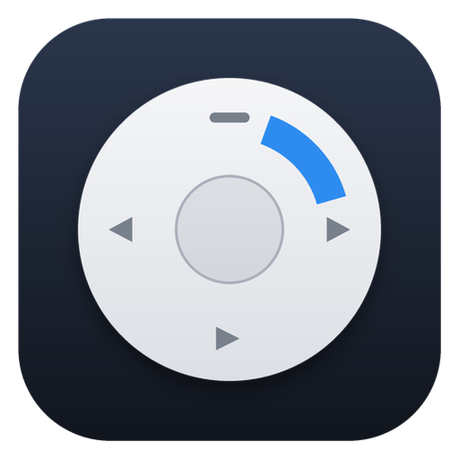
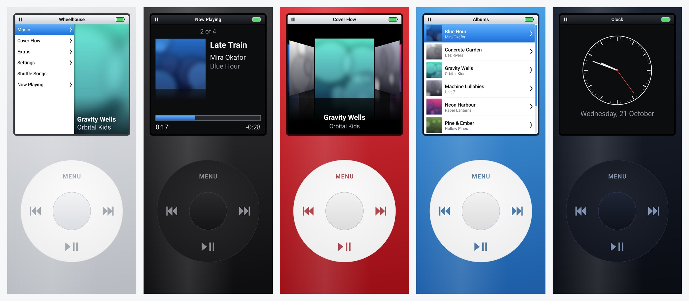

<div align="center">



# Wheelhouse

**Turn an old Android phone into a dedicated, click-wheel music player.**

Wheelhouse is a home-screen replacement (launcher) that makes the whole phone a classic
pocket music player: a screen on top, a click wheel below, and nothing else to get in the way.

[](https://github.com/pronzzz/Wheelhouse/releases/latest/download/Wheelhouse.apk)
&nbsp;
[](#requirements)
&nbsp;
[](LICENSE)



</div>

## Why

That phone in your drawer still has a headphone jack, a decent DAC and a battery that lasts
for hours of music. What it doesn't need is notifications, feeds and a dozen apps.

Set Wheelhouse as the home app and the phone boots straight into a music player. Press the
Home button and you are back at the main menu. No accounts, no internet, no ads, no tracking.

## Features

**A real click wheel**
- Drag around the ring to scroll, with a click sound and haptic tick on every step
- Tap **Menu**, **⏮**, **⏭**, **⏯** and the centre button, just like the original
- Hold **Menu** for the main menu, hold **⏮/⏭** to rewind or fast-forward, hold the centre for options
- Three wheel speeds; touch scrolling and tapping on the screen also work
- Hardware keyboards, D-pads and TV remotes work too

**Your music, browsed the classic way**
- Split-screen main menu with a slowly panning album-art preview
- Playlists, Artists, Albums, Songs, Genres and Search (spelled with the wheel)
- **Cover Flow** with perspective covers and reflections
- Smart playlists: Loved, Recently Added, Most Played, Recently Played
- Your own playlists: create, add, remove, rename, delete
- Fast-scroll letter overlay in long lists; long titles scroll on the highlighted row

**Now Playing**
- Album art with reflection, "3 of 12", elapsed and remaining time
- Turn the wheel for volume. Press the centre to cycle **Scrub → Shuffle → Repeat**
- Up Next queue, Play Next, Add to Up Next, Love, Go to Album/Artist, song info
- Returns to Now Playing on its own after 30 seconds without input (can be turned off)
- The queue is remembered and restored (paused) after a restart

**Built to be the only thing on the phone**
- Works as the **Home app**: the phone starts into Wheelhouse, Home always returns to the main menu
- Full-screen mode, in-app battery indicator, keep-awake on the charger (a nice dock clock)
- **Extras**: Clock, Stopwatch, Sleep Timer (15–90 min or end of song) and an **Apps** list,
  so you can still reach Settings, Bluetooth, the camera or anything else
- Background playback, lock-screen and notification controls, headphone and Bluetooth buttons,
  pause when headphones are unplugged

**Light enough for very old hardware**
- Android 5.0 (Lollipop) and newer, 1.3 MB download
- Every screen is drawn directly on a canvas, no heavy UI toolkit
- Artwork is memory-capped and loaded off the main thread
- **Lite Mode** (on automatically for low-RAM phones) turns off animations and reflections

**Make it yours**
- Nine device colours: Silver, Black, Midnight, Red, Blue, Green, Pink, Gold, Rockstar
- Light or dark screen, backlight level, click sound and haptics on/off

## Get started

1. **Download** [`Wheelhouse.apk`](https://github.com/pronzzz/Wheelhouse/releases/latest/download/Wheelhouse.apk)
   on the phone and open it. Android will ask you to allow installs from your browser or file manager.
2. **Copy music** to the phone's `Music` folder (USB cable, SD card or a file manager).
3. **Open Wheelhouse**, choose **Allow Music Access**, then **Set as Home Screen**.

That's it. The full guide, including tips for turning an old phone into a long-lasting
music appliance (battery care, removing distractions, Bluetooth), is in
**[docs/SETUP.md](docs/SETUP.md)**.

### Leaving Wheelhouse

Go to **Settings › Home Screen › Switch to Another Home App…** and pick your old launcher.
You can also open any app from **Extras › Apps**.

## Controls

| Control | Tap | Hold |
| --- | --- | --- |
| Wheel ring (drag) | Scroll / volume / scrub | – |
| **Menu** | Back | Main menu |
| **Centre** | Select | Options for the highlighted song |
| **⏯** | Play / pause | Now Playing |
| **⏮ / ⏭** | Previous / next song | Rewind / fast-forward |

In **Now Playing**, press the centre repeatedly to switch what the wheel controls:
volume → scrub → shuffle → repeat.

## Requirements

- Android 5.0 or newer. v1.0 has been tested on Android 16 (phone and a simulated 480×854
  budget screen); if it misbehaves on your older phone, please
  [open an issue](https://github.com/pronzzz/Wheelhouse/issues) with the model and Android version.
- Music stored on the phone: MP3, AAC/M4A, FLAC, Ogg Vorbis, Opus, WAV and anything else your
  phone can play
- No internet connection or account needed, ever

## Building from source

```bash
git clone https://github.com/pronzzz/Wheelhouse.git
cd Wheelhouse
./gradlew assembleDebug        # app/build/outputs/apk/debug/app-debug.apk
./gradlew testDebugUnitTest    # unit tests
```

You need JDK 17 and the Android SDK (platform 35). See [docs/BUILDING.md](docs/BUILDING.md)
for release signing, and [docs/ARCHITECTURE.md](docs/ARCHITECTURE.md) for how the code is organised.

## Privacy

Wheelhouse has no internet permission, so it cannot send anything anywhere. It reads your
music library, keeps its own small database of playlists and play counts on the phone, and
that's it.
See [PRIVACY.md](PRIVACY.md).

## Roadmap

- Shuffle by album, ratings, lyrics
- Kid/kiosk lock (PIN to leave Wheelhouse or open Apps)
- Folder browsing and excluded folders
- Podcasts and audiobooks with resume
- Built-in games (Brick, Music Quiz)
- Translations

Ideas and bug reports are welcome in [Issues](https://github.com/pronzzz/Wheelhouse/issues).

## Credits

- Inspired by Apple's iPod classic and by [Classipod](https://github.com/adeeteya/Classipod),
  a lovely cross-platform take on the same idea. Wheelhouse is an independent, native Android
  implementation written from scratch.
- Wheelhouse grew out of the earlier **PocketPod** project in this repository.
- Not affiliated with or endorsed by Apple Inc. iPod and Cover Flow are trademarks of Apple Inc.

## License

[MIT](LICENSE) © 2026 Pranav Dwivedi and Wheelhouse contributors
